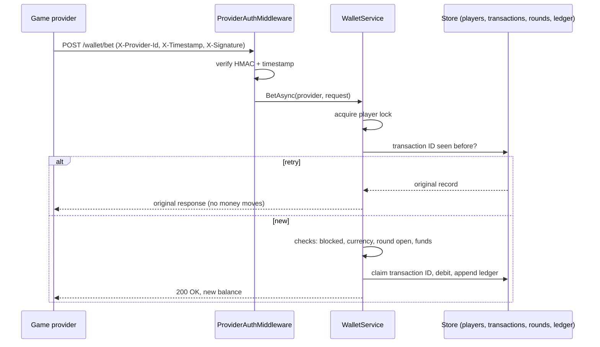

# Game Wallet API (.NET)

[](https://github.com/VerginisV/game-wallet-api/actions/workflows/ci.yml)

A **seamless wallet** for casino game provider integrations, built with ASP.NET Core minimal APIs on .NET 10.

In a seamless integration the game provider (slots, live casino, crash games) never holds the player's money. On every spin it calls the operator's wallet: *take this bet*, *pay this win*, *cancel that bet*. The wallet has to stay correct when calls are retried, arrive out of order, or arrive at the same time. That is what this project is about.

## The hard parts it handles

| Situation | What happens |
| --- | --- |
| Provider retries a bet after a timeout | Same transaction ID and same content → the original response, **no second charge** |
| Same transaction ID reused for a different bet | `409 TRANSACTION_CONFLICT`, nothing changes |
| 50 bets arrive at once on a small balance | A per-player async lock serializes them; the wallet **never goes negative** |
| Provider rolls back a bet that never reached us | Answer OK and leave a **tombstone**; when the late bet arrives it is refused, not charged |
| Rollback after the round already paid out | `422 ROLLBACK_NOT_ALLOWED` |
| Player blocked mid-round | New bets refused, but wins for accepted bets **are still paid** |
| Forged or replayed request | HMAC-SHA256 signature over timestamp and body, 5-minute window |
| "Did we lose any money?" | Append-only ledger and a reconciliation endpoint: opening balance + ledger = balance |

All amounts are integers in minor units (250 = €2.50), so there is no floating point anywhere.

## Architecture



```
src/GameWallet.Api
├── Domain/Wallet.cs              Player, TransactionRecord, Round, LedgerEntry, WalletStatus
├── Wallet/WalletService.cs       bet / win / rollback / balance rules
├── Wallet/WalletStore.cs         storage interface + in-memory implementation
├── Wallet/WalletEndpoints.cs     /wallet routes, status → HTTP code mapping
├── Concurrency/KeyedLock.cs      one async lock per player
├── Security/                     provider HMAC signatures, admin API key
└── Admin/PlayerAdmin.cs          create/block players, ledger, reconciliation
```

## API

### Provider calls (signed)

Every call needs three headers:

```
X-Provider-Id: demo-provider
X-Timestamp:   1763390000                       (unix seconds)
X-Signature:   hex(HMAC-SHA256(secret, "{timestamp}.{raw body}"))
```

| Endpoint | Body |
| --- | --- |
| `POST /wallet/balance` | `{ "playerId", "currency" }` |
| `POST /wallet/bet` | `{ "transactionId", "playerId", "roundId", "gameId", "amount", "currency" }` |
| `POST /wallet/win` | `{ "transactionId", "playerId", "roundId", "amount", "currency", "roundClosed" }` |
| `POST /wallet/rollback` | `{ "transactionId", "playerId", "roundId", "referenceTransactionId" }` |

Every response has the same shape:

```json
{ "status": "OK", "balance": 9750, "currency": "EUR", "transactionId": "tx-1" }
```

| Status | HTTP |
| --- | --- |
| `OK` | 200 |
| `INVALID_REQUEST` | 400 |
| `INVALID_SIGNATURE` | 401 |
| `PLAYER_BLOCKED` | 403 |
| `PLAYER_NOT_FOUND`, `ROUND_NOT_FOUND` | 404 |
| `TRANSACTION_CONFLICT` | 409 |
| `INSUFFICIENT_FUNDS`, `CURRENCY_MISMATCH`, `ROUND_CLOSED`, `TRANSACTION_ROLLED_BACK`, `ROLLBACK_NOT_ALLOWED` | 422 |

Error responses still carry the current balance, so the game can show it.

### Back office (`X-Api-Key`)

| Endpoint | Purpose |
| --- | --- |
| `POST /admin/players` | Create a player `{ "playerId", "currency", "openingBalance" }` |
| `GET /admin/players/{id}` | Balance and status |
| `POST /admin/players/{id}/block` | `{ "blocked": true }` |
| `GET /admin/players/{id}/ledger` | Every balance change with the running balance |
| `GET /admin/reconciliation` | Checks opening balance + ledger = balance for every player |

## Run it

Requires the [.NET 10 SDK](https://dotnet.microsoft.com/download).

```bash
dotnet run --project src/GameWallet.Api      # http://localhost:5090, seeds player-1 (€100) and player-2 (€5)
```

Then play a round with the signing helper (needs `openssl` and `curl`):

```bash
scripts/wallet-call.sh balance '{"playerId":"player-1","currency":"EUR"}'
scripts/wallet-call.sh bet '{"transactionId":"tx-1","playerId":"player-1","roundId":"r-1","gameId":"slot-fruits","amount":250,"currency":"EUR"}'
scripts/wallet-call.sh win '{"transactionId":"tx-2","playerId":"player-1","roundId":"r-1","amount":1000,"currency":"EUR","roundClosed":true}'
curl -H "X-Api-Key: dev_admin_key_change_me" http://localhost:5090/admin/reconciliation
```

Try the late-bet case:

```bash
scripts/wallet-call.sh rollback '{"transactionId":"rb-1","playerId":"player-2","roundId":"r-9","referenceTransactionId":"tx-lost"}'
scripts/wallet-call.sh bet '{"transactionId":"tx-lost","playerId":"player-2","roundId":"r-9","gameId":"slot-fruits","amount":100,"currency":"EUR"}'
# → TRANSACTION_ROLLED_BACK, balance unchanged
```

Or with Docker:

```bash
docker build -t game-wallet-api .
docker run -p 8080:8080 -e ASPNETCORE_ENVIRONMENT=Development game-wallet-api
```

The secrets in `appsettings.Development.json` are for local use only. In production set `Providers__Secrets__<providerId>` and `Admin__ApiKeys__0` from a secret store.

## Tests

```bash
dotnet test
```

45 xUnit tests:

- **Wallet rules:** retries, conflicts, rollbacks, tombstones, closed rounds, blocked players, per-provider transaction IDs, ledger.
- **Concurrency:** 50 parallel bets on a €10 balance, the same bet sent 30 times at once, bet and rollback racing, and 200 mixed rounds that must reconcile.
- **Signatures:** HMAC, timestamp window.
- **HTTP:** the real app on a local port, called like a provider would.

## Production notes

This is a portfolio project. Storage is **in memory** behind `IWalletStore` and the lock is in-process, so it runs as a **single instance**. To make it production-ready:

- **Storage:** SQL Server or PostgreSQL with a unique index on `(provider_id, transaction_id)`. Each call becomes one database transaction, and a row lock on the player (`SELECT ... FOR UPDATE` / `UPDLOCK`) replaces `KeyedLock`.
- **Real money and bonus money:** split balances with a defined spending order.
- **Responsible gaming:** deposit and loss limits checked in the bet path.
- **Provider adapters:** each provider has its own field names and error codes, so a thin adapter per provider would map to this core.
- **Observability:** metrics and alerts on reconciliation mismatches.

## License

MIT
